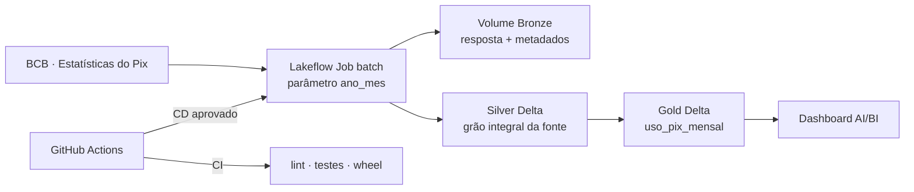

# Pulso Pix

[](https://github.com/lucasvidalsilva/projeto-pulso-pix-databricks/actions/workflows/ci.yml)
[](https://github.com/lucasvidalsilva/projeto-pulso-pix-databricks/actions/workflows/cd.yml)

Pipeline batch de engenharia e produto de dados sobre o Pix, construído com dados públicos do Banco Central do Brasil e executado no Databricks Free Edition.

**Estado:** a V0 está implementada para as competências de 2025. O repositório registra a implantação em `dev`, a preservação das respostas brutas, a publicação de Silver e Gold em Delta e o consumo por um dashboard AI/BI. A auditoria local reproduz os testes unitários que não dependem do workspace; deploy, tabelas e dashboard exigem acesso ao ambiente Databricks.

- [Mapa do projeto](docs/mapa-do-projeto.md): funcionamento, evidências, evolução e limites.
- [Decisões arquiteturais](docs/decisoes): fonte, carga, reexecução, armazenamento, Gold e CD.
- [Instruções de desenvolvimento](AGENTS.md): método, ambiente e regras de entrega.
- [Política de segurança](SECURITY.md): tratamento de credenciais e vulnerabilidades.

## Problema e recorte

Estatísticas oficiais do Pix são agregadas e possuem um grão detalhado. Consumir esses dados com segurança exige selecionar o mês correto, preservar a origem, rejeitar respostas parciais ou inválidas e reconciliar agregações antes de publicar indicadores.

A primeira entrega responde:

> Como quantidade e valor do Pix variaram ao longo de 2025 por natureza, forma de iniciação e regiões pagadora e recebedora?

A fonte é `EstatisticasTransacoesPix`, do BCB, limitada a `202501`–`202512`. Esses dados não representam transações individuais e não sustentam inferências causais.

## Arquitetura implementada



| Camada | Implementação | Evidência versionada |
| --- | --- | --- |
| Bronze | bytes originais e `metadados.json` em Volume gerenciado | `estatisticas_pix.py` e ADR 006 |
| Silver | validação de contrato e overwrite seletivo por `ano_mes` | SQL, tarefa e testes unitários |
| Gold | mês × natureza × iniciação × regiões, com valor e quantidade | `uso_pix_mensal.sql` e ADR 010 |
| Consumo | dashboard AI/BI incluído no bundle | JSON do dashboard e ADR 011 |
| Operação | bundle com `dev`; `prod` valida sem provisionar recursos | `databricks.yml` e `resources/` |

O [mapa do projeto](docs/mapa-do-projeto.md) registra 163.161 linhas na Silver e 16.496 combinações na Gold para 2025. São evidências da execução documentada no workspace, não resultados recalculados nesta cópia local.

## Stack e decisões

- **Python/PySpark:** ingestão, contrato da fonte, rastreabilidade e escrita Delta.
- **SQL:** transformações declarativas de Silver e Gold.
- **Delta Lake e Unity Catalog:** tabelas gerenciadas e separação por schemas.
- **Databricks Asset Bundles:** recursos e parâmetros versionados.
- **GitHub Actions:** CI sem credenciais e CD restrito ao environment `dev`.
- **pytest e Ruff:** verificações locais do código empacotável.

O workspace Free Edition não permitiu os catálogos separados originalmente propostos. A V0 usa o catálogo `workspace`, com schemas `bronze`, `silver` e `gold`, apenas em `dev`. O target `prod` não representa um ambiente produtivo nem um SLA.

## Executar localmente

Pré-requisitos: Python 3.11+, Git e [uv](https://docs.astral.sh/uv/).

```bash
uv sync --group dev
uv run ruff check .
uv run ruff format --check .
uv run pytest tests/unitarios
```

Os testes locais cobrem contrato da fonte, retries, preservação do bruto, validações de medidas e grão, SQL versionado e estrutura do dashboard. Eles não substituem uma execução Spark no Databricks.

## Validar e executar no Databricks

Use a Databricks CLI atual e um perfil autenticado. Nenhuma credencial deve ser adicionada ao repositório.

```bash
databricks bundle validate --strict -t dev --profile PULSO_PIX
databricks bundle validate --strict -t prod --profile PULSO_PIX
databricks bundle deploy -t dev --profile PULSO_PIX
databricks bundle run estatisticas_pix -t dev --profile PULSO_PIX --params ano_mes=202501
```

O dashboard documentado pode ser aberto em [Pulso Pix — uso em 2025](https://dbc-6f6e2ab0-1349.cloud.databricks.com/dashboardsv3/01f1c0dca5481bbc9007062a6b7297b7/published?w=7474650652244145). Sua disponibilidade e aparência dependem do workspace e devem ser verificadas separadamente.

## Limitações e próximos passos

- a execução real depende de autenticação, quotas e disponibilidade do Databricks Free Edition e da API do BCB;
- a fonte é agregada e exclui liquidações internas do próprio participante;
- não há streaming, CDC, simulador nem ML nesta entrega;
- `prod` é apenas uma configuração validável, sem recursos implantados;
- ampliar a série histórica ou adicionar fontes exige nova decisão de produto e de grão.

O roadmap e as decisões pendentes ficam no [mapa do projeto](docs/mapa-do-projeto.md), evitando duplicar documentação.
